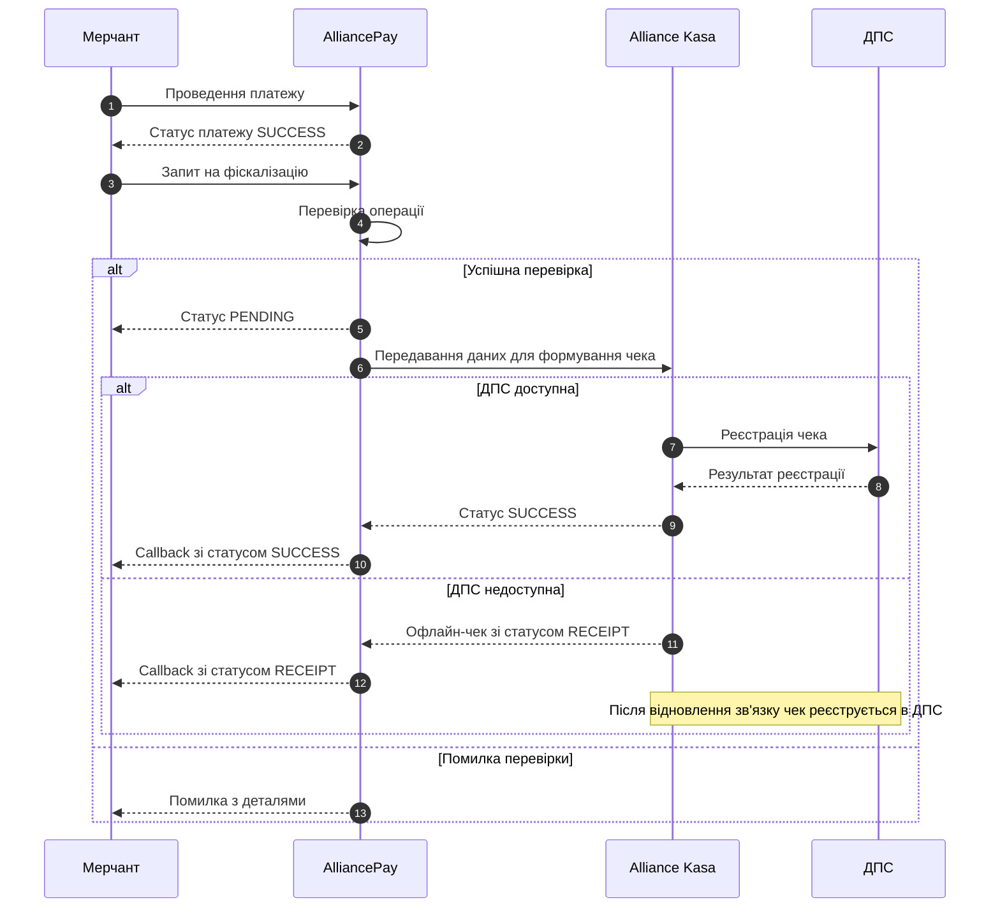

# Фіскалізація платежів

### Загальна інформація

Фіскалізація платежів — це процес формування електронних фіскальних чеків та їх реєстрації в Державній податковій службі України (ДПС).

Платформа **AlliancePay** забезпечує можливість фіскалізації платіжних операцій через інтеграцію із сервісом **Alliance Kasa**.

Після успішного проведення платіжної операції мерчант може надіслати API-запит на фіскалізацію. На підставі переданих даних формується фіскальний чек, який надалі реєструється в ДПС.

> **Важливо:** Підключення фіскалізації не означає автоматичного створення фіскальних чеків після кожної транзакції. Для фіскалізації платіжної операції необхідно окремо викликати відповідний API-метод.

### Підтримувані операції

Фіскалізація доступна для таких типів платіжних операцій:

| Тип операції                   | Опис                                                                             |
| ------------------------------ | -------------------------------------------------------------------------------- |
| `PURCHASE`                     | Фіскалізація успішної операції оплати товарів або послуг.                        |
| `REFUND` — повне повернення    | Формування фіскального чека повернення на повну суму раніше проведеної оплати.   |
| `REFUND` — часткове повернення | Формування фіскального чека повернення на частину суми раніше проведеної оплати. |

Інші типи платіжних операцій не підтримуються в межах поточного функціоналу фіскалізації.

### Умови виконання фіскалізації

Перед надсиланням запиту необхідно переконатися, що:

* Функціонал фіскалізації підключено та активовано для відповідного мерчанта.
* Платіжна операція успішно завершена та має фінальний статус `SUCCESS`.
* Тип платіжної операції підтримує фіскалізацію.
* Запит містить коректний ідентифікатор платіжної операції та всі необхідні дані для формування фіскального чека.
* Дані про товари або послуги передано в полі `products`. Для кожної позиції вказано назву, кількість, ціну за одиницю в копійках, код одиниці виміру та, за потреби, податкові й акцизні дані.

> **Важливо:** Операції зі статусами `PENDING`, `FAIL` або іншими статусами, що не підтверджують успішне завершення платежу, фіскалізувати не можна.

Для фіскалізації операцій повернення необхідно використовувати ідентифікатор успішно виконаної операції повернення, а не ідентифікатор початкового платежу.

### Процес фіскалізації

Фіскалізація виконується за таким сценарієм:

**Важливо:** Процес фіскалізації є асинхронним. Успішне прийняття запиту на обробку не означає, що фіскальний чек уже зареєстровано в ДПС.
