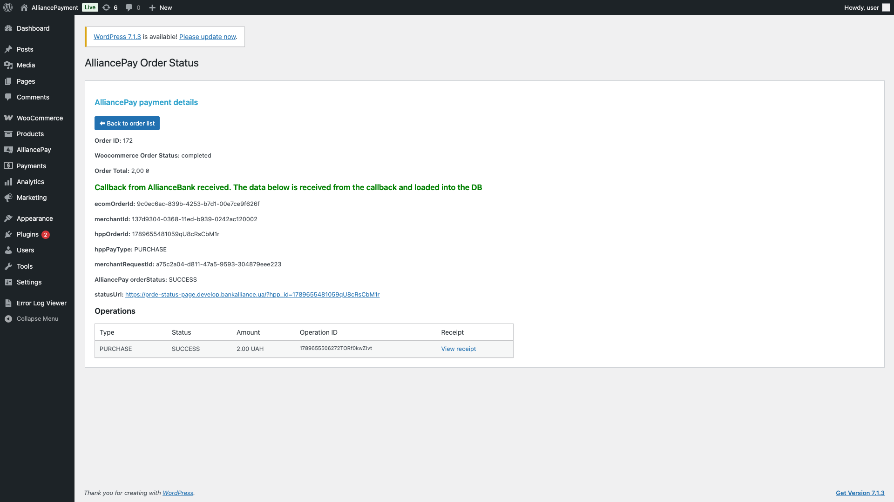
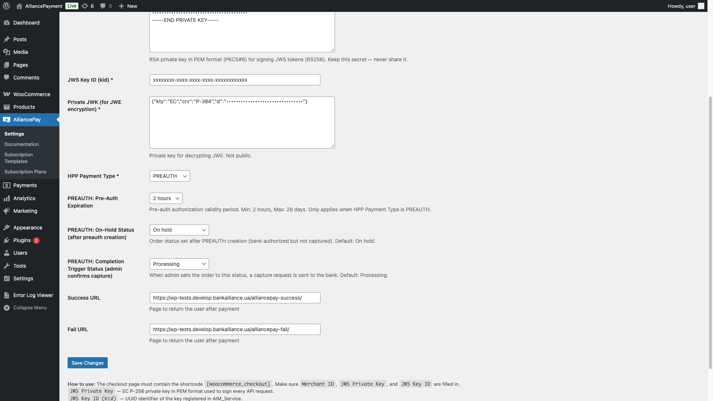
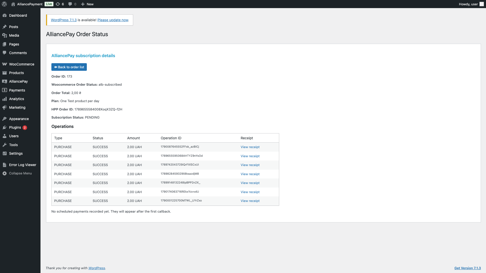
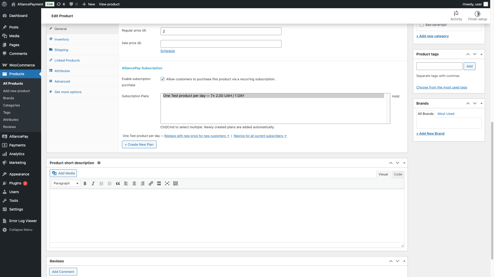
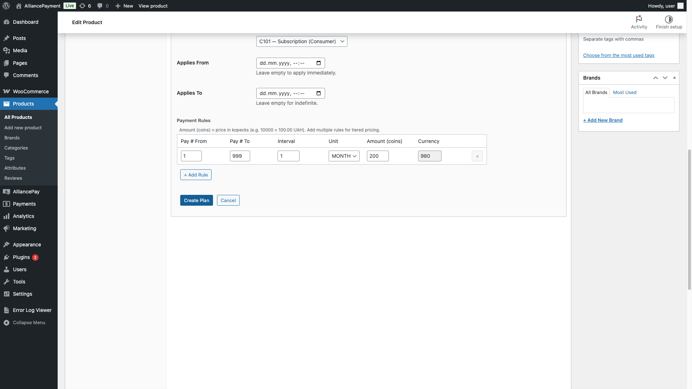
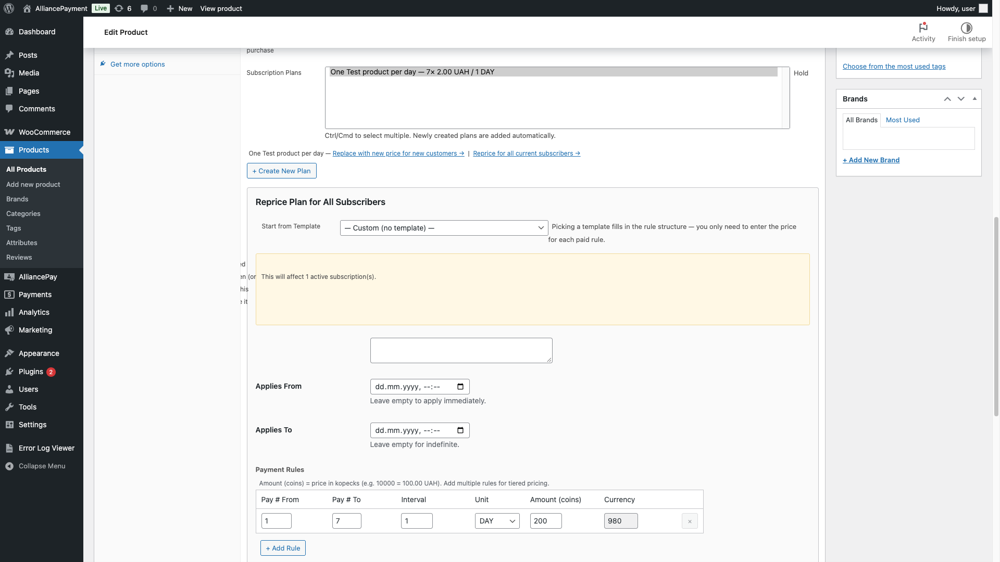

# Функціонал

Модуль AlliancePay для WooCommerce підтримує оплату на HPP, попередню авторизацію з подальшим списанням, повернення коштів і підписки. Запити підписуються за правилами Авторизації 2.0. Опис відповідає офіційному плагіну [v1.8.0](https://github.com/alliancedigital-tech/alliancepay-woocommerce/releases/tag/v1.8.0).

### Сторінка оплати

Після увімкнення способу оплати в **WooCommerce → Налаштування → Платежі** покупець може вибрати AlliancePay. Модуль створює замовлення в платіжній системі й перенаправляє покупця на HPP. Результат оплати надходить до магазину через підписаний callback.

Для класичного оформлення замовлення використовуйте сторінку з шорткодом `[woocommerce_checkout]`. Описаний нижче сценарій підписки також розрахований на класичне оформлення. Плагін має інтеграцію зі звичайною оплатою у WooCommerce Checkout Blocks.

### Список і деталі замовлень

У списку замовлень WooCommerce додається колонка **AlliancePay payment status**. Для замовлень, оплачених через AlliancePay, кнопка **Статус платежу** відкриває деталі операцій. Якщо callback не надійшов, модуль показує відповідне попередження.

Після отримання callback сторінка відображає збережені дані. Якщо callback відсутній, модуль запитує інформацію в API банку. Зіставляйте статус замовлення WooCommerce, результат платіжної операції та примітки замовлення. Перехід покупця на Success URL сам по собі не підтверджує оплату.

<figure><figcaption>
PURCHASE: приклад отриманого callback та успішної операції зі статусом SUCCESS.
</figcaption></figure>

### PREAUTH і підтвердження списання

<figure><figcaption>
PREAUTH: тип платежу, строк резервування та статус запуску COMPLETION.
</figcaption></figure>

1. У налаштуваннях AlliancePay виберіть **HPP Payment Type → PREAUTH**, строк резервування та статуси замовлення.
2. Після успішного резервування коштів перевірте callback і дані операції. Замовлення переходить у налаштований **On-Hold Status**.
3. Коли потрібно списати кошти, переведіть замовлення у статус, заданий у **Completion Trigger Status**. Типове значення — **Processing**.
4. Перевірте результат COMPLETION у примітках і статусі платежу. Остаточний результат обробляється через callback.

**Перехід у статус підтвердження запускає реальне списання коштів.** Для запиту потрібен ідентифікатор операції PREAUTH, отриманий у callback. Списання виконуйте до завершення строку резервування. У v1.8.0 модуль перевіряє, щоб сума підтвердження була в межах ±20% початкової суми авторизації; остаточну можливість операції визначає банк. У разі помилки модуль додає примітку та повертає попередній статус замовлення.

### Повернення коштів

У деталях замовлення WooCommerce оформіть повернення, вкажіть суму та скористайтеся поверненням через AlliancePay. Модуль підтримує повне й часткове повернення для відповідної вихідної операції PURCHASE або COMPLETION. Для A2A повернення цим механізмом не підтримується.

**У v1.8.0 переведення замовлення у статус Refunded також може автоматично запустити повне повернення, якщо його ще не зареєстровано.** Враховуйте це перед зміною статусу. Прийняття запиту зі статусом `PENDING` ще не означає завершення повернення: перевірте результат операції та примітки замовлення.

### Підписки

Підписка пов’язує товар WooCommerce із платіжним планом AlliancePay. План визначає послідовність, періодичність, суми та валюту платежів. Перше оформлення проходить через HPP; наступні платежі виконуються платіжною системою за правилами плану, а їхні результати надходять через callback.

#### 1. Створення шаблону

Відкрийте **AlliancePay → Subscription Templates**. Укажіть код, назву й категорію шаблону, а для кожного правила — діапазон платежів **Pay # From / To**, інтервал, одиницю **DAY / WEEK / MONTH** та ознаку **Priced?**. Збережіть шаблон.

Шаблон містить структуру графіка без конкретної ціни та прив’язки до товару. Якщо на його основі вже створено план, для іншої структури створіть новий шаблон. Архівування шаблону прибирає його з вибору для нових планів і не скасовує чинні підписки.

#### 2. Створення плану для товару

1. Відкрийте редагування товару й блок **AlliancePay Subscription** у загальних налаштуваннях товару.
2. Увімкніть **Enable subscription purchase**.
3. Виберіть наявні **Subscription Plans** або натисніть **Create New Plan**. Для кількох планів використовуйте Ctrl/Cmd.
4. Виберіть шаблон або **Custom**, заповніть назву, опис за потреби, категорію та правила платежів. Перевірте дати початку й завершення дії плану.
5. Збережіть план і товар. Новий план додається до вибраних планів товару.

| Поле правила    | Що вказати                                                           |
| --------------- | -------------------------------------------------------------------- |
| Pay # From / To | Номери платежів, до яких застосовується правило.                     |
| Interval / Unit | Кількість і одиницю періоду між платежами: день, тиждень або місяць. |
| Amount (coins)  | Суму в мінімальних одиницях валюти. Наприклад, 10000 = 100,00 грн.   |
| Currency        | Числовий код валюти; для гривні — 980.                               |

Назва плану — до 150 символів, опис — до 255. Ціна товару WooCommerce і суми в правилах плану — окремі параметри: зміна ціни товару не замінює зміну платіжного плану.

#### 3. Оформлення покупцем

1. Покупець входить у свій обліковий запис магазину.
2. На сторінці товару вибирає **Purchase type → Subscribe** та потрібний план. Для разової покупки використовується **One-time purchase**.
3. Оформлює підписку окремим замовленням: інші товари не повинні бути в кошику разом із товаром за підпискою.
4. На класичній сторінці оформлення вибирає AlliancePay і переходить на HPP.

Після успішної першої оплати та обробки callback замовлення WooCommerce отримує статус **Active Subscription**. Для подальшої діагностики перевіряйте також результат операції та записи запланованих платежів.

#### 4. Перегляд підписки та платежів

<figure><figcaption>
Рекурентні платежі: деталі підписки та історія успішних операцій. Платежі на цьому екрані мають тип PURCHASE.
</figcaption></figure>

У замовленні відкрийте **Статус платежу**. Для підписки відображаються дані плану, HPP-замовлення, статус підписки, заплановані платежі й операції. Події повторних списань також додаються до приміток замовлення.

**Локальний статус підписки PENDING не тотожний статусу платежу.** У v1.8.0 він може зберігатися й після успішної першої оплати, коли замовлення вже має статус Active Subscription. Підтверджуйте оплату за результатом конкретної операції та callback.

| Статус запланованого платежу | Значення                                  |
| ---------------------------- | ----------------------------------------- |
| WAITING                      | Очікує виконання.                         |
| PROCESSING                   | Запущений, результат ще обробляється.     |
| SUCCESS                      | Платіж успішний.                          |
| RETRY                        | Передбачена повторна спроба.              |
| FAIL\_WITHOUT\_RETRY         | Невдала спроба без автоматичного повтору. |
| SKIPPED\_PAUSED              | Платіж пропущений через призупинення.     |
| INVALIDATED                  | Платіж більше не є чинним.                |

У блоці **AlliancePay Subscription Payments** кнопка **Run Now** доступна для платежів у станах WAITING, RETRY або FAIL\_WITHOUT\_RETRY за наявності ідентифікатора запланованого платежу. **Вона надсилає запит на фактичне списання**, а не лише оновлює інформацію. Після запуску дочекайтеся результату через callback; стан PROCESSING не є підтвердженням успіху.

#### 5. Зміна ціни

У блоці AlliancePay Subscription товару є два різні сценарії:

| Дія                                      | Результат                                                                                   |
| ---------------------------------------- | ------------------------------------------------------------------------------------------- |
| Replace with new price for new customers | Створює новий план для нових оформлень. Чинні підписники залишаються на попередньому плані. |
| Reprice for all current subscribers      | Оновлює правила чинного плану для його підписників із заданої майбутньої дати.              |

Для масової зміни вкажіть повний набір нових правил і дату набрання чинності щонайменше через **30 днів**. Підтвердьте, що підписники вже повідомлені або будуть повідомлені до цієї дати. За потреби додайте причину. Модуль зберігає попередні й нові правила, версії та запис аудиту.

#### 6. Скасування підписки

Покупець відкриває **My Account → My Subscriptions** та натискає **Cancel Subscription** для потрібної підписки. Після успішної відповіді банку модуль установлює статус CANCELED і скасовує відповідне замовлення WooCommerce.

Скасування підписки припиняє її подальше виконання й не є поверненням уже сплачених коштів. Повернення оформлюється окремою операцією.

#### 7. Список планів та аудит

**AlliancePay → Subscription Plans** показує технічні дані планів, прив’язку до товарів, стан синхронізації та кількість активних підписок. Нижче доступний журнал останніх дій. Для створення плану або зміни ціни користуйтеся відповідними діями в товарі.

### Приклади налаштувань підписки

Ілюстрації з інструкції WordPress: блок підписки в товарі, форма створення плану та сценарії зміни ціни.

**Налаштування підписки в товарі**

<figure><figcaption></figcaption></figure>

Увімкнення підписки та вибір планів для товару.

<figure><figcaption></figcaption></figure>

Створення плану: періодичність, сума та валюта платежів.

<figure><figcaption></figcaption></figure>

Окремі дії для нових покупців і чинних підписників.
