# Функціонал

### Як покупець оплачує замовлення

Покупець додає товари в кошик VirtueMart, вибирає **AlliancePay** і підтверджує замовлення. Плагін формує запит із сумою, валютою, типом платежу та даними платника. Магазин перенаправляє покупця на платіжну сторінку AlliancePay (Hosted Payment Page).

Для **PURCHASE** покупець підтверджує разову оплату, за потреби проходить 3-D Secure і бачить результат. Для **A2A** він підтверджує платіж з рахунку на рахунок. Після повідомлення банку (callback) плагін оновлює статус замовлення у VirtueMart.

### Як списати зарезервовані кошти — PREAUTH та Completion

1. Після успішної **PREAUTH** банк резервує суму на картці. У VirtueMart замовлення отримує статус очікування передавторизації, наприклад **Pending**.
2. Коли товар готовий і можна списати кошти, відкрийте замовлення та переведіть його в статус, вибраний у полі **Статус-тригер для списання (Completion)**. У наведеній конфігурації це **Confirmed**. Виконайте дію протягом строку передавторизації.
3. Плагін надсилає запит на списання. Відкрийте історію транзакцій і перевірте результат Completion. Після спливу строку банк може зняти резерв.

### Де перевірити платіж

У **Компоненти → VirtueMart → Orders & Shoppers → Orders** відкрийте замовлення за номером у колонці **Order number/Invoice**. У блоці **Payment Method → Історія транзакцій Alliance** звірте HPP Order ID, тип та ідентифікатор операції, суму, статус і дату. Якщо стан замовлення викликає сумнів, натисніть **Оновити** у блоці оновлення транзакцій та статусів.

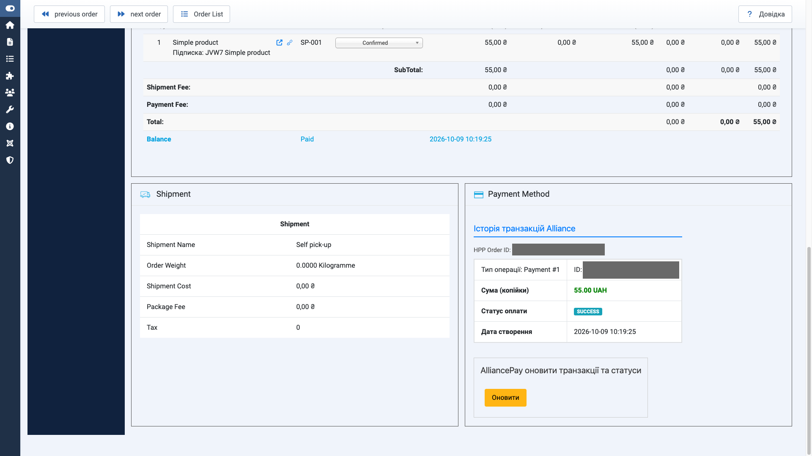

### Як повернути кошти

Відкрийте оплачене замовлення та переконайтеся, що вихідна операція списання має статус **SUCCESS**.

* **Часткове повернення.** У блоці **Часткове повернення коштів (Alliance)** позначте товари. Звірте розраховану суму й натисніть **Виконати повернення для обраних товарів**.
* **Повне повернення.** У блоці **Full Refund (AlliancePay)** перевірте замовлення та натисніть **Execute Order Refund**.

В історії транзакцій перевірте окрему операцію **REFUND**, її суму й результат. Після повного успішного повернення позиції замовлення отримують статус **Refunded**. Зміна статусу вручну сама по собі не підтверджує банківське повернення.

### Як запропонувати підписку на товар

Підписки доступні з версії 1.6.0. Увімкніть їх у конфігурації способу оплати та перевірте, що плагін **VMCustom - AlliancePay Subscription** і компонент **Підписки AlliancePay** увімкнені.

#### Прив’яжіть поле підписки до товару

У **VirtueMart → Products → Custom Fields** створіть поле типу **Plug-ins**, введіть назву, наприклад **AlliancePay Subscription**, і виберіть **Published → Yes**. У **Additional Parameters** виберіть **VMCustom - AlliancePay Subscription**. Укажіть, чи показувати розклад плану на сторінці товару, та збережіть поле.

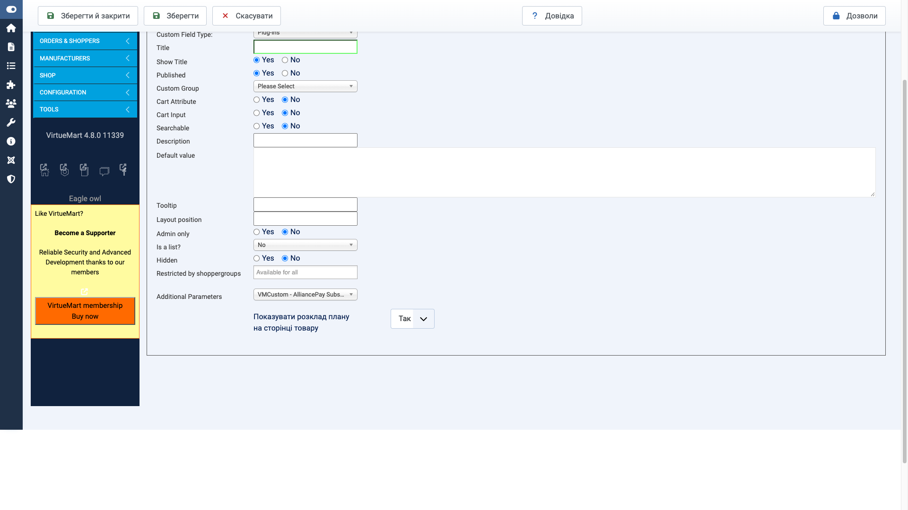

Відкрийте товар VirtueMart, додайте створене поле на вкладці користувацьких полів і збережіть товар. Посилання **Керувати планами підписки цього товару** відкриває плани для цього товару.

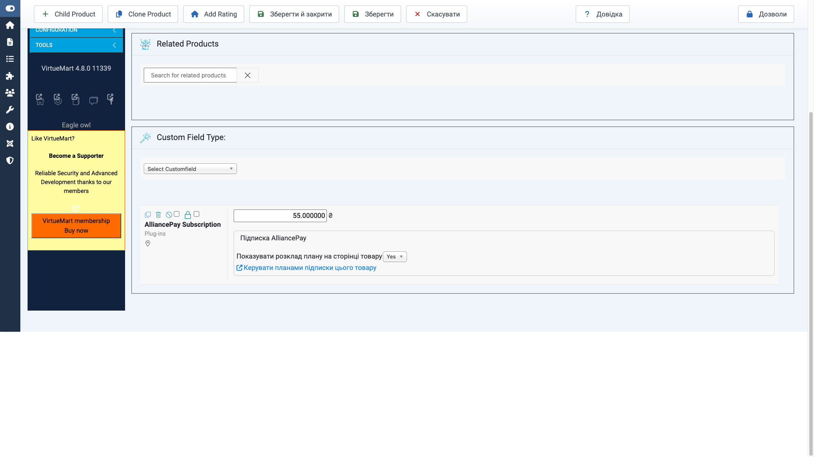

#### Створіть шаблон і план

У **Компоненти → Підписки AlliancePay → Шаблони** натисніть **Новий шаблон**. Задайте код, назву та правила розкладу. Список показує статус кожного шаблону й чи використовується він планом.

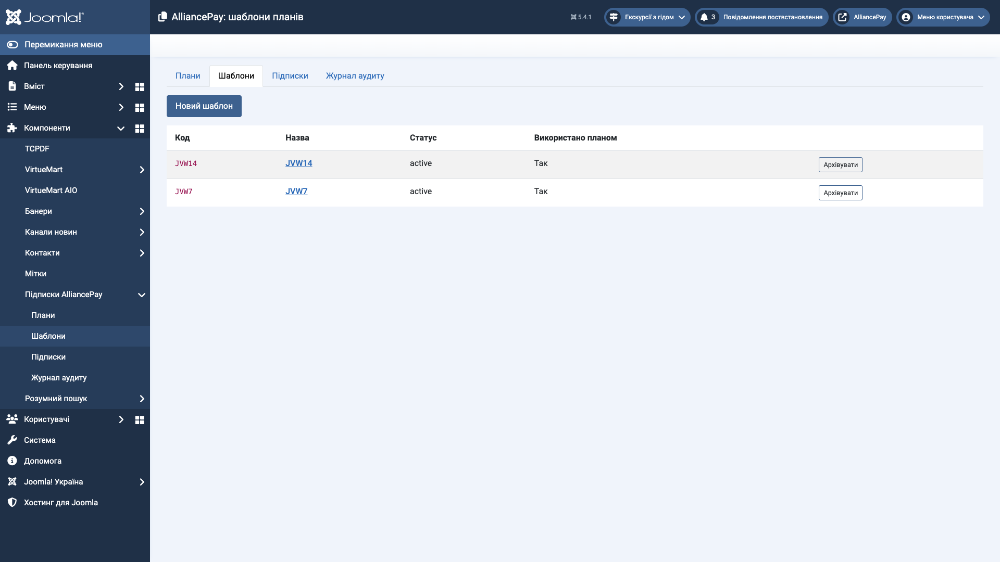

На вкладці **Плани** натисніть **Новий план**. Виберіть товар VirtueMart і шаблон, задайте умови та збережіть. Перевірте статус, ID плану в провайдера та колонку **Пропонується новим клієнтам**. Тут також видно кількість активних підписок.

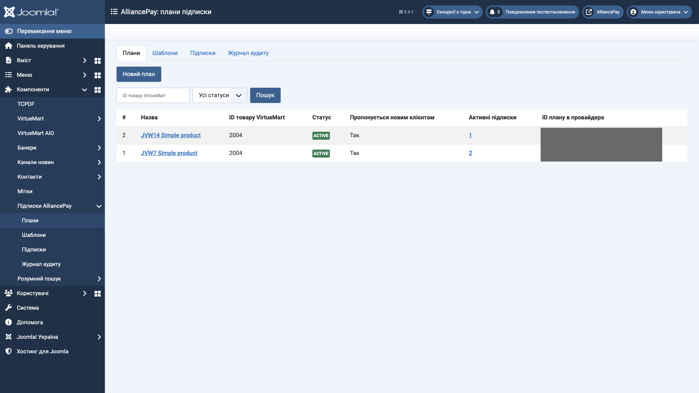

У картці плану перевірте версію, стан синхронізації, номери платежів, суми та інтервал. Наприклад, рядок «1–14 / 55,00 UAH / 1 дн.» означає 14 щоденних платежів по 55 грн. Дія **Більше не пропонувати новим клієнтам** закриває план для нових оформлень. Для зміни ціни чинних підписок відредагуйте розклад, зазначте дату набуття чинності й причину, підтвердьте повідомлення клієнтів і перевірте кількість підписок, яких торкнеться зміна. Найранішу дату визначає строк попередження в конфігурації.

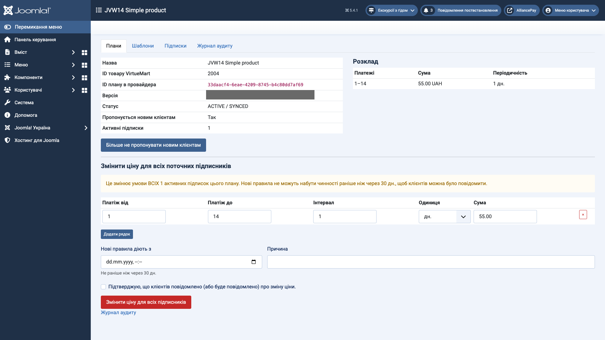

#### Налаштуйте меню покупця та планувальник

У меню Joomla! створіть пункт із назвою **Мої підписки**. У виборі типу розгорніть **Підписки AlliancePay** і виберіть пункт підписок. У показаній версії він може відображатися як `COM_ALLIANCEPAY_SITE_MENU_SUBSCRIPTIONS`. Збережіть і опублікуйте пункт у меню покупця.

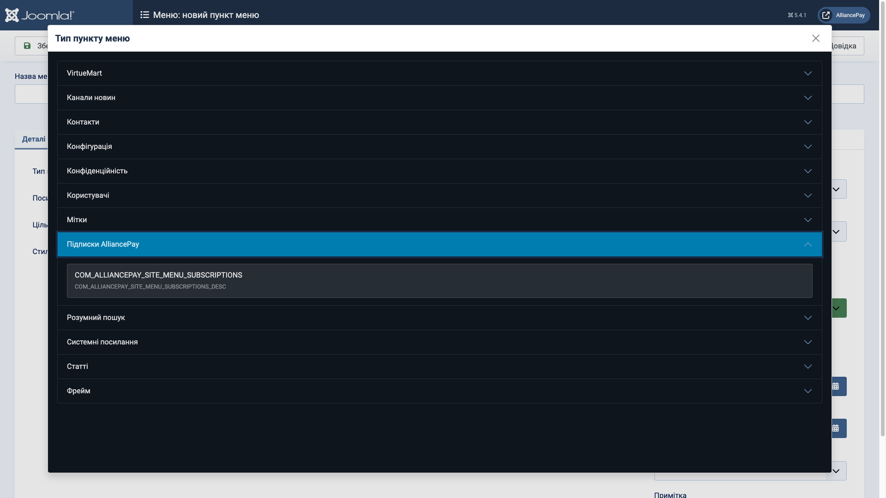

Перевірте, що плагін **Завдання - AlliancePay** увімкнений. У планувальнику Joomla! створіть потрібне завдання AlliancePay, задайте назву, правило, інтервал виконання та ввімкніть його. Завдання **AlliancePay: пошук планів для архівації** позначає кандидатами плани, які вже не пропонуються й не мають активних підписників. Архівація в банку є окремою дією.

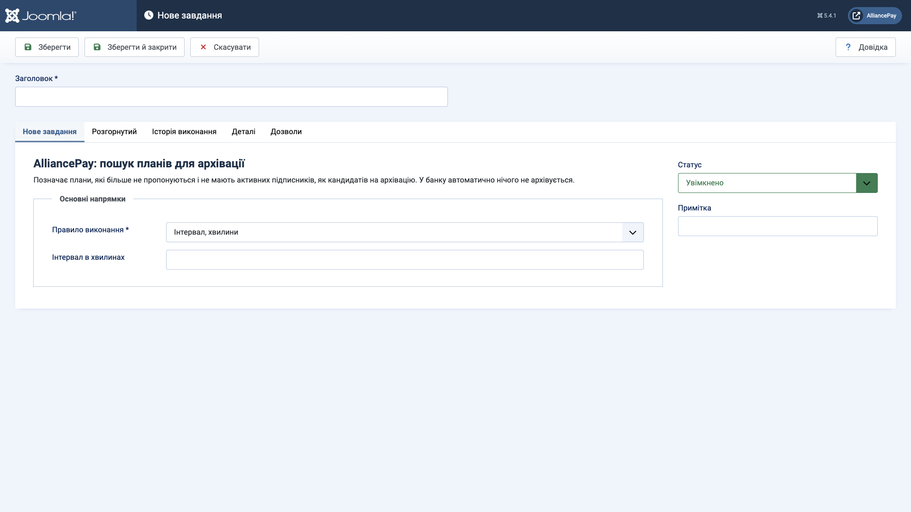

#### Оформлення та перевірка підписки

На сторінці товару покупець може вибрати **Купити одноразово**. Щоб оформити підписку, він входить у свій обліковий запис, вибирає **Оформити підписку** і план, додає товар у кошик та завершує першу оплату через AlliancePay. Підписка прив’язується до цього облікового запису й доступна в розділі **Мої підписки**.

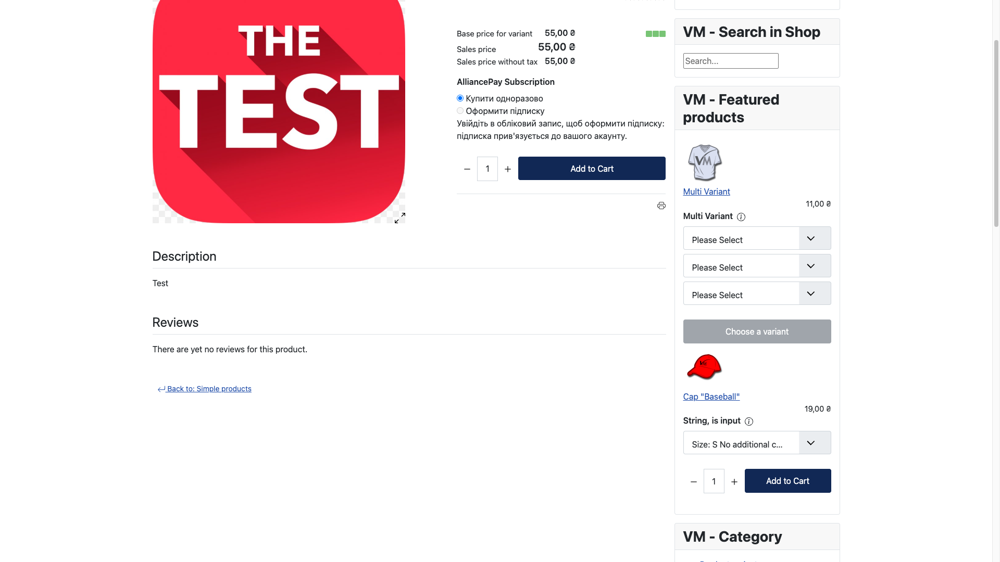

В адміністративній панелі відкрийте **Підписки AlliancePay → Підписки** й виберіть запис. Картка містить план, пов’язане замовлення, правила на момент оформлення та заплановані платежі з результатами і кількістю спроб. Блок **Операції в провайдера** оновлюється при відкритті картки. Для припинення підписки скористайтеся дією **Скасувати підписку**.

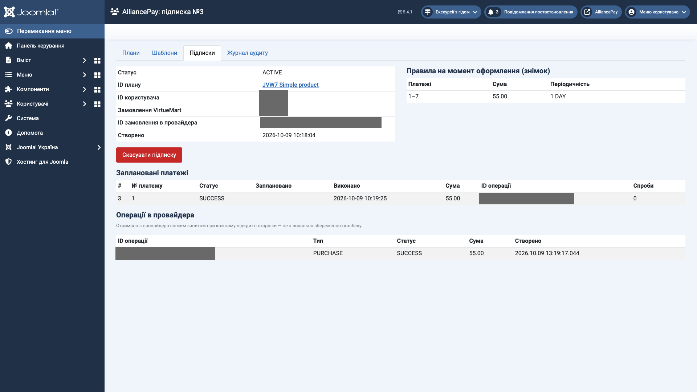

У **Журналі аудиту** можна звірити час дії, план, користувача та деталі запису. Наприклад, `template_created` означає створення шаблону, а `plan_created` — створення плану.

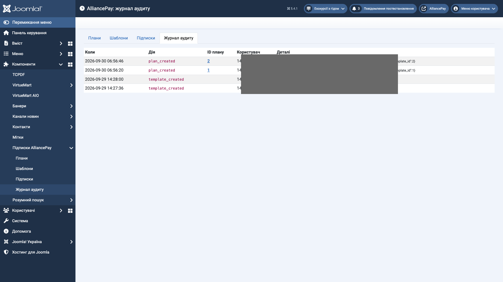
