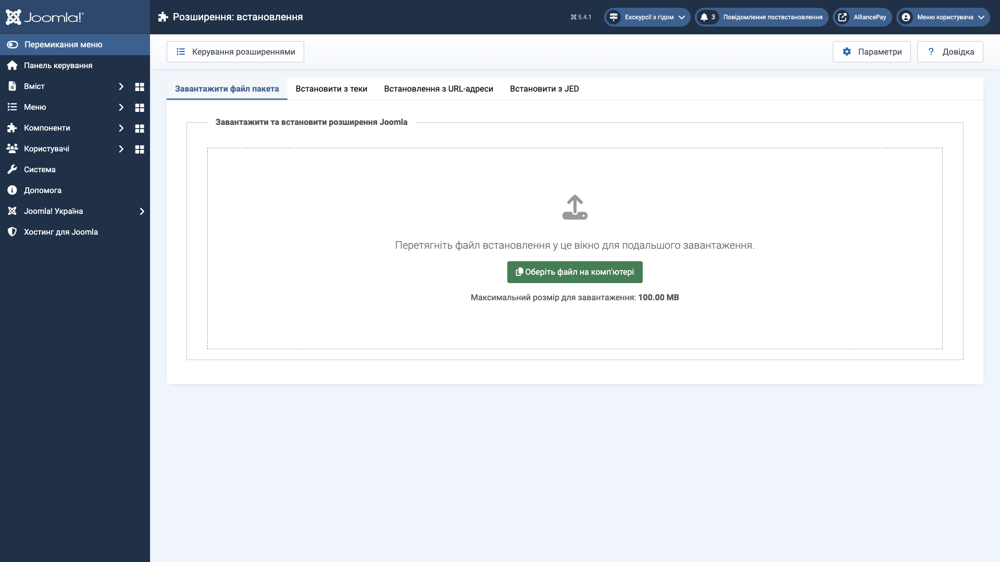
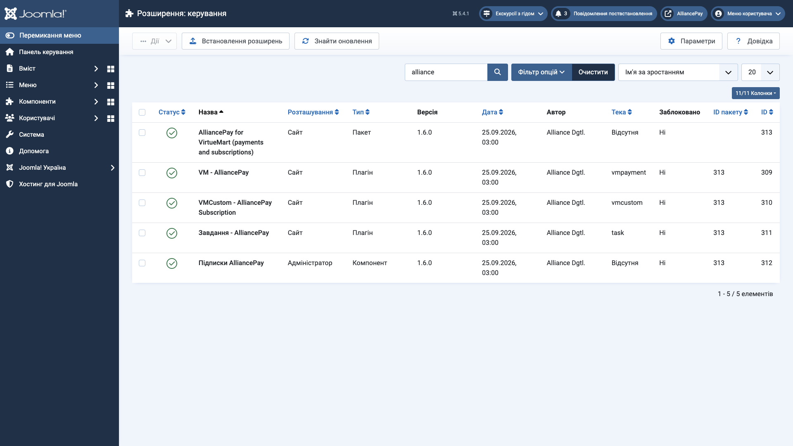

# Інструкція по встановленню

Для магазину на Joomla! 5 і VirtueMart 4 установіть ZIP-пакет AlliancePay. Приклад нижче показує Joomla! 5.4.1, VirtueMart 4.8.0 і пакет AlliancePay 1.6.0 з підтримкою платежів та підписок.

### Перед встановленням

Перевірте, що VirtueMart уже встановлено, версія PHP сумісна з обома системами, а сервер магазину може звертатися до API банку через HTTPS. Перевірте дату, час і часовий пояс сервера.







### Завантажте пакет у Joomla!

1. Завантажте інсталяційний ZIP для потрібної версії зі [сторінки релізів AlliancePay для VirtueMart](https://github.com/alliancedigital-tech/alliancepay-joomla-virtuemart/releases). Для підписок виберіть повний пакет **AlliancePay for VirtueMart (payments and subscriptions)**.
2. У панелі адміністратора Joomla! перейдіть у **Система → Встановлення → Розширення**. Якщо ви вже на сторінці «Керування розширеннями», натисніть **Встановлення розширень**.
3. На вкладці **Завантажити файл пакета** натисніть **Оберіть файл на комп’ютері** або перетягніть ZIP у поле завантаження. Дочекайтеся повідомлення про завершення встановлення.

### Перевірте встановлені розширення

Натисніть **Керування розширеннями**, введіть `alliance` в пошуку та перевірте стовпець **Статус**. Для повного пакета 1.6.0 список містить п’ять записів.

* **AlliancePay for VirtueMart (payments and subscriptions)** — пакет розширень.
* **VM - AlliancePay** — платіжний плагін VirtueMart.
* **VMCustom - AlliancePay Subscription** — користувацьке поле підписки для товару.
* **Завдання - AlliancePay** — плагін завдань планувальника Joomla!.
* **Підписки AlliancePay** — компонент керування планами та підписками.

Якщо потрібний плагін вимкнений, позначте його та виберіть **Дії → Увімкнути**. Відкрийте **Компоненти → VirtueMart → Shop → Payment Methods**. Під час створення способу оплати в полі **Payment Method** має з’явитися **VM - AlliancePay**.

