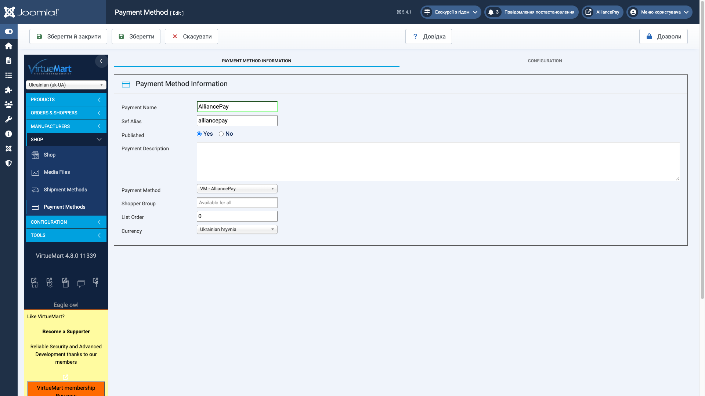
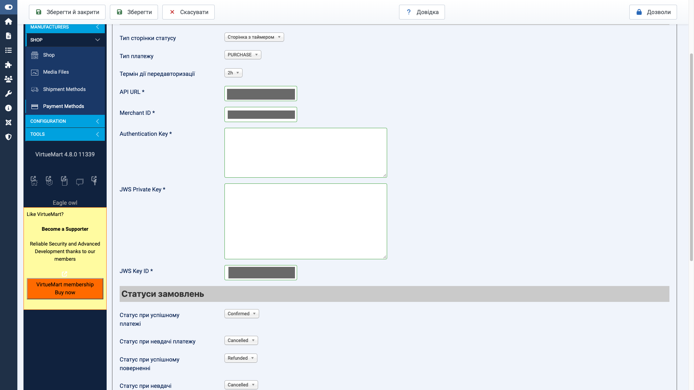
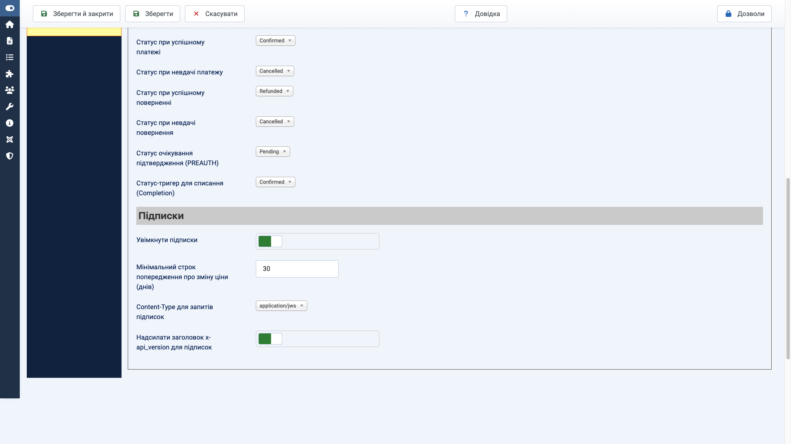
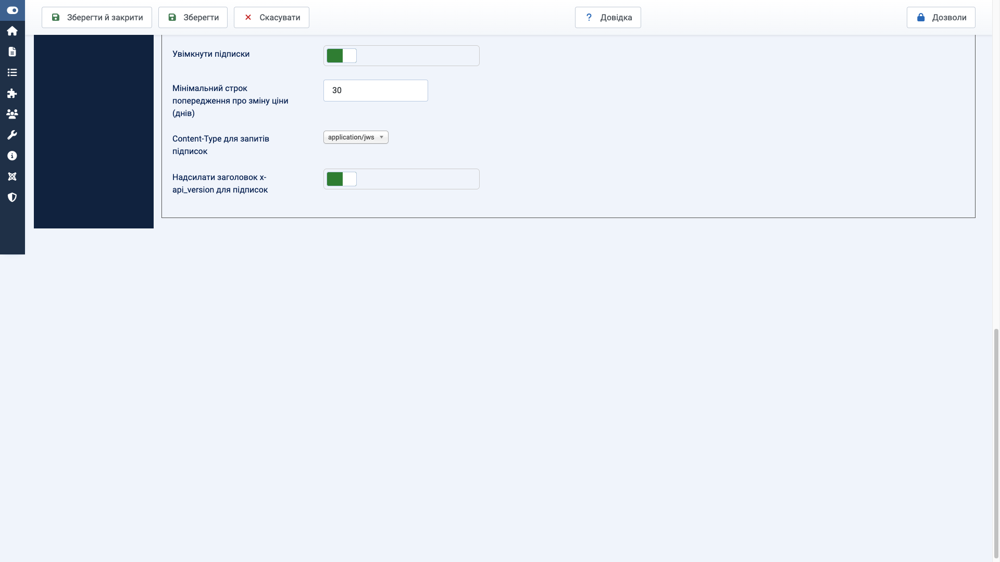

# Налаштування та авторизація

### Створіть спосіб оплати

У панелі адміністратора відкрийте **Компоненти → VirtueMart → Shop → Payment Methods**. Створіть спосіб оплати або відкрийте наявний. На вкладці **Payment Method Information** укажіть **Payment Name** (наприклад, AlliancePay) і **Sef Alias** (наприклад, alliancepay). У полі **Payment Method** виберіть **VM - AlliancePay**. Установіть валюту методу та збережіть картку, щоб відкрити вкладку **Configuration**. Щоб показати налаштований метод у кошику, установіть **Published → Yes**.

### Підключіть магазин через JWS

Підготуйте пару ключів для середовища, з яким працюватиме магазин. Зареєструйте в банку публічний ключ. Приватний ключ зберігайте на стороні магазину. Порядок реєстрації описано в розділі [Авторизація 2.0](https://docs.merchant.alb.ua/avtorizaciya-2.0).

Заповніть обов’язкові поля вкладки **Configuration** для одного й того самого середовища та мерчанта.

| Поле у VirtueMart  | Що вказати                                                                                                  |
| ------------------ | ----------------------------------------------------------------------------------------------------------- |
| API URL            | Адресу API, надану банком для тестового або промислового середовища.                                        |
| Merchant ID        | Ідентифікатор мерчанта для обраного типу платежу.                                                           |
| Authentication Key | Секретний ключ автентифікації запитів до API. Пакет 1.6.0 має для нього окреме поле.                        |
| JWS Private Key    | Приватний ключ, яким плагін підписує запити. Він має відповідати публічному ключу, зареєстрованому в банку. |
| JWS Key ID         | Ідентифікатор зареєстрованого ключа (kid), за яким банк перевіряє підпис.                                   |

### Виберіть тип платежу та сторінку результату

* **PURCHASE** — разова оплата зі списанням коштів.
* **A2A** — платіж з рахунку на рахунок. Використовуйте реквізити термінала, для якого банк увімкнув A2A.
* **PREAUTH** — резервування коштів до окремого списання (Completion). У полі **Термін дії передавторизації** виберіть погоджений із банком строк. На ілюстрації — 2 години.

У полі **Тип сторінки статусу** виберіть, що побачить покупець після операції. `STATUS_TIMER_PAGE` показує результат і потім повертає до магазину, `STATUS_REDIRECT_MERCHANT_PAGE` одразу повертає покупця на сайт, а `STATUS_PAGE` відкриває сторінку результату AlliancePay.

### Зіставте статуси замовлень

Виберіть статуси свого магазину. У таблиці наведено значення з прикладу налаштування.

| Подія або дія у VirtueMart              | Приклад статусу |
| --------------------------------------- | --------------- |
| Успішний платіж                         | Confirmed       |
| Невдалий платіж                         | Cancelled       |
| Успішне повернення                      | Refunded        |
| Невдале повернення                      | Cancelled       |
| Очікування після успішної PREAUTH       | Pending         |
| Статус-тригер для списання (Completion) | Confirmed       |

Для замовлення з активною передавторизацією перехід у статус-тригер запускає запит на списання. Результат перевіряйте в історії транзакцій.

### Увімкніть підписки, якщо магазин їх пропонує

У блоці **Підписки** увімкніть **Увімкнути підписки** й укажіть мінімальний строк попередження клієнтів про зміну ціни. У прикладі він становить 30 днів. Для запитів підписок у прикладі вибрано `application/jws` і ввімкнено передавання заголовка `x-api-version`.

Натисніть **Зберегти й закрити**. Оформте тестове замовлення й перевірте операцію в картці замовлення VirtueMart.
